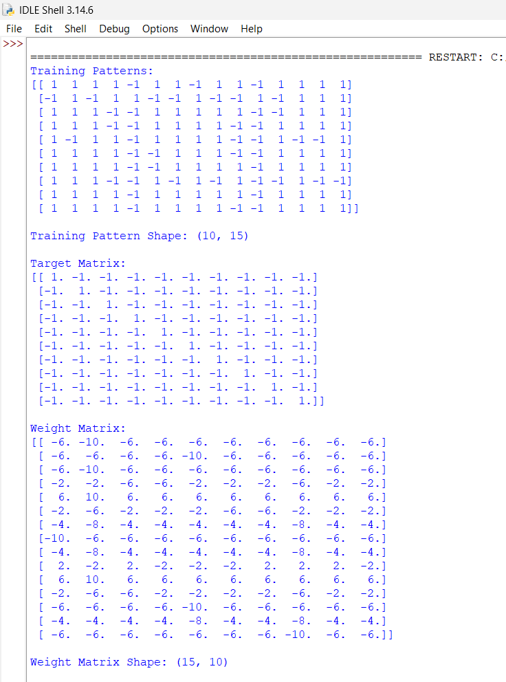

# Hebb Net Digit Recognition

## 📌 Project Overview

This project implements a **Hebbian Neural Network (Hebb Net)** using Python and NumPy to recognize handwritten-style digits from 0 to 9.

Each digit is represented using a 5×3 binary pattern containing 15 pixels. The network learns these patterns using the Hebbian Learning Rule and recognizes digits by calculating the output of the trained weight matrix.

## 🎯 Objectives

* Implement Hebbian Learning using Python.
* Train a neural network to recognize digits from 0 to 9.
* Understand weight matrix formation.
* Test digit recognition using normal patterns.
* Test recognition with one-pixel errors.

## 🛠️ Technologies Used

* Python
* NumPy

## 🧠 Algorithm Used

**Hebbian Learning Rule**

Hebbian learning is a basic learning principle in neural networks.

It follows the concept:

"Neurons that fire together, wire together."

The weight matrix is calculated using:

W = Σ (X × T)

Where:

* W = Weight Matrix
* X = Input Pattern
* T = Target Pattern

## ⚙️ Working Process

1. Define training patterns for digits 0 to 9.
2. Create a target matrix for the ten output neurons.
3. Initialize the weight matrix with zeros.
4. Apply the Hebbian Learning Rule to calculate weights.
5. Accept a 5×3 test pattern from the user.
6. Calculate network output using the dot product.
7. Use argmax() to identify the recognized digit.
8. Test the network again with a one-pixel error pattern.

## 📂 Project Structure

```text
Hebb-Net-Digit-Recognition/
│
├── hebb_net.py
├── requirements.txt
└── README.md
```

## ▶️ How to Run

**Step 1: Clone the repository**

```bash
git clone https://github.com/dshruti743-sudo/Hebb-Net-Digit-Recognition.git
```

**Step 2: Install the required library**

```bash
pip install -r requirements.txt
```

**Step 3: Run the Python program**

```bash
python hebb_net.py
```

## 🧪 Testing

The project performs two types of testing:

* Normal Pattern Testing: Recognizes digits using the original training patterns.
* One Pixel Error Testing: Checks whether the network can recognize a digit when one pixel is changed.

## 📊 Output

The program displays:

* Training patterns
* Target matrix
* Weight matrix
* Weight matrix dimensions
* Network output
* Recognized digit

## ⚠️ Limitations

* Uses predefined 5×3 digit patterns.
* Recognition accuracy depends on the similarity of the input pattern to trained patterns.
* One-pixel error recognition is not guaranteed for every digit.
* The network always selects the output neuron with the highest activation.

## 🚀 Future Scope

* Improve recognition accuracy.
* Add more training patterns.
* Develop a graphical user interface.
* Explore recognition of larger and more complex patterns.
  ## 📸 Project Screenshots

### Training and Weight Matrix



### Digit Recognition


## 👩‍💻 Author

**Shruti Desai**

GitHub: [dshruti743-sudo](https://github.com/dshruti743-sudo)
